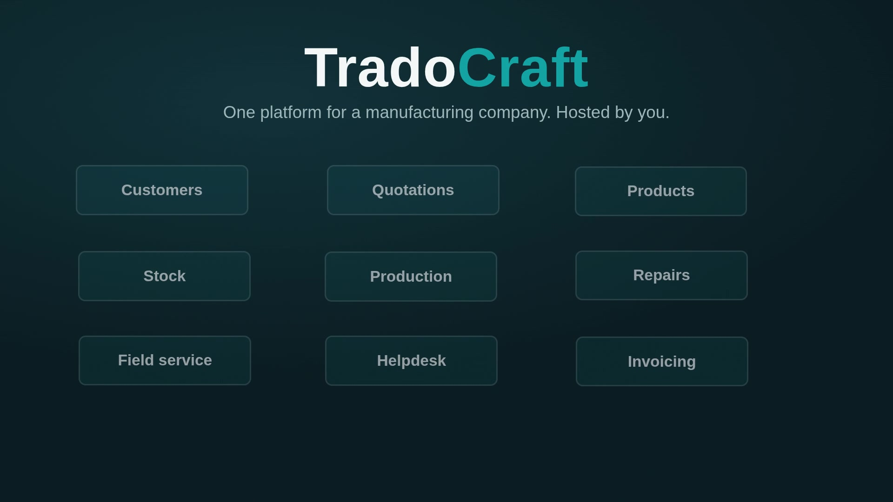
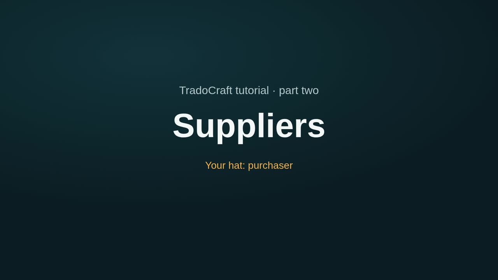
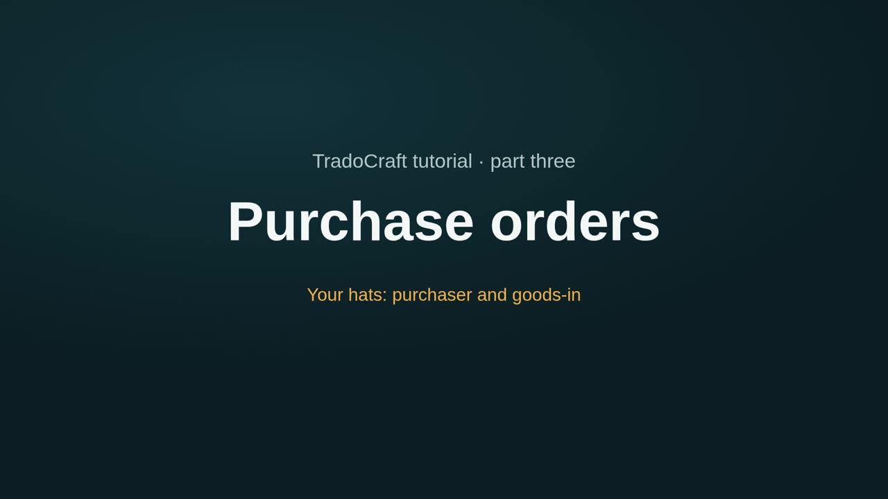

# tradocraft

An integrated business platform for a manufacturing and service company:
CRM, quotations, products, inventory, production, repairs, field service, helpdesk and invoicing,
built to progressively replace a CRM and an external accounting package. Inspired by the breadth of open-source ERPs, built around
our own processes.

**Stack:** Rust (Axum, SQLx) · PostgreSQL · Flutter (Windows, Android, iOS, web) · Typst for PDFs.

> **Status: pre-1.0 (v0.3.0 is the latest release).** Interfaces, configuration and database schema may
> still change in a minor release; see the [CHANGELOG](CHANGELOG.md) and the [versioning policy](docs/RELEASING.md).
> Modules that exist: CRM (customers, contacts, opportunities), products with price zones, rebates and
> price lists, quotations and sales orders, customer invoices, stock, purchasing and delivery, production
> with work centres, material requirements planning and planning boards, bills of materials with serial
> numbers, helpdesk, knowledge base and customer portal, field service with an offline technician
> queue, reports, data import and an audit log. Clients: a Flutter app (Windows, Android, iOS, web) and a
> Leptos web frontend at `/app/` that so far covers only some workflows (see the roadmap).
> Not included: statutory accounting (it stays in an external package, [ADR 0008](docs/adr/0008-accounting-stays-external.md)),
> and two-factor authentication. Not yet done for a first distributable release:
> several security findings, a signed Android build and real-world testing of some features
> (see "First release checklist" in the [ROADMAP](docs/ROADMAP.md)). The packaged Docker and Windows
> demo setups are for local evaluation only (development sign-in); do not expose them to a network.
> Architecture and plans: [ARCHITECTURE](docs/ARCHITECTURE.md), [ROADMAP](docs/ROADMAP.md).


https://github.com/user-attachments/assets/5c0a13d6-0781-4483-b2d3-06a2690ea5f5

### Introduction and tutorial videos

[Explore the interactive tutorial database visualizer](https://tradocraft.github.io/TradoCraft/tutorial-db-visualizer.html) to follow each chapter from the Flutter interface through the Rust API to PostgreSQL.

Short walkthroughs recorded from the real app in a tutorial environment. The voiceover is AI-generated.
Click a picture to play the video. ([All releases](https://github.com/TradoCraft/TradoCraft/releases))

**Introduction and tutorial, part one** (2 min 9 s): what TradoCraft is, the welcome chapter, the keyboard shortcut badges
(hold Alt or Ctrl) and building a conveyor belt assembly with its motors, drive, assembly drawing and bill of materials.

[](https://github.com/TradoCraft/TradoCraft/releases/download/video-intro-tutorial-part-1/tradocraft-introduction-and-tutorial-part-one.mp4)

**Tutorial, part two: suppliers** (1 min 20 s): two suppliers and their price lists, with unit price, lead time and minimum order quantity.

[](https://github.com/TradoCraft/TradoCraft/releases/download/video-tutorial-part-2-suppliers/tradocraft-tutorial-part-two-suppliers.mp4)

**Tutorial, part three: purchase orders** (1 min 41 s): ordering components, approving and sending the order, receiving the goods in two deliveries and checking the stock.

[](https://github.com/TradoCraft/TradoCraft/releases/download/video-tutorial-part-3-purchase-orders/tradocraft-tutorial-part-three-purchase-orders.mp4)

## Repository layout

```
apps/api/            HTTP server: wires modules, OpenAPI, migrations, integration tests
crates/core/         errors, auth (OIDC / dev), companies, numbering, audit trail and its viewer, VAT validation and VIES lookup, accent-insensitive search
crates/pricing/      pure pricing engine (no I/O): zone prices, discounts, rounding, VAT
crates/crm/          customers, contacts (people), per-company commercial terms, opportunities
crates/products/     products, price zones, price history
crates/sales/        quotations: drafts, snapshots, revisions, PDF data
crates/engineering/  BOM revisions, explosion, serial units and genealogy
crates/helpdesk/     tickets from e-mail and phone, threading, prepared answers, outbox, IMAP
crates/portal/       customer portal: passwordless login for contacts, their tickets, repairs and profile
crates/repairs/      repairs customers send in, workshop departments, routing workflow, photos
crates/fieldservice/ jobs at customer sites for technicians: tasks, work logs, photos
apps/worker/         background worker: IMAP polling, sending the e-mail outbox, heartbeat
apps/portal-api/     customer-facing HTTP server: only the portal, public knowledge base and survey routes
crates/documents/    Typst PDF rendering, Belgian number formatting
migrations/          SQLx migrations (one PostgreSQL schema per module)
templates/           Typst document templates (nl / fr / en)
seed/                development seed data (fictitious)
api/openapi.json     generated API contract (source of the Dart client)
app/                 Flutter application
docs/                architecture and decision records
```

## Running a packaged release

**Portable Windows x64 demo.** Download the demo ZIP from [Releases](https://github.com/TradoCraft/TradoCraft/releases), extract it, and run **Start TradoCraft Demo.exe**. The demo setup EXE installs the same bundle for the current user and adds Start menu shortcuts. Both include PostgreSQL and Typst and run offline using fictitious tutorial data. See [the demo instructions](deploy/windows/README.txt) for data, logs, and reset.

**Docker release.** On Windows, start Docker Desktop in Linux container mode. Download `docker-compose.yml` from
the [release](https://github.com/TradoCraft/TradoCraft/releases) into a folder and run:

```bash
echo "POSTGRES_PASSWORD=$(openssl rand -hex 16)" > .env   # there is no default password
docker compose up -d
```

(On Windows PowerShell set `$env:POSTGRES_PASSWORD` to a value of letters and digits instead.)

- **Web UI** — open http://localhost:8088 and use the local tutorial sign-in.
- **Windows app** — download and extract `tradocraft-windows-x64.zip`, open
  `tradocraft_app.exe`, and connect to http://localhost:8080.

Both use the same local backend and database. Compose pulls the prebuilt images and starts
PostgreSQL automatically. The backend image includes Typst. The packaged setup is for local
evaluation and uses development sign-in with loopback-bound ports.

## Running locally

Prerequisites: Rust (stable), PostgreSQL 16, [Typst](https://typst.app) CLI, Flutter SDK.

```bash
cp .env.example .env    # set POSTGRES_PASSWORD (there is no default)
docker compose up --build
```

or without Docker, against a local PostgreSQL:

```bash
cp .env.example .env    # adjust DATABASE_URL (use your own database password)
set -a; source .env; set +a
cargo run -p tradocraft-api
```

The API listens on `http://localhost:8080`; interactive API docs are at `/docs`.
With `SEED_DEV_DATA=true` a demo company is created with users `admin@example.com`,
`sales@example.com`, `manager@example.com` (sales manager), `support@example.com`,
`production@example.com`, `viewer@example.com` and `integration@example.com` (a service account
that imports configured quotations and can read customers, products and all quotations of the
company, but cannot edit or send them by hand) (development authentication only). The seed also loads a
demo configurator, a fictitious conveyor line
(`seed/configurators/conveyor_line.json`, [ADR 0034](docs/adr/0034-configurators.md)). `EXTRA_SEED_DIR`
adds your own `*.sql` demo data after the seed, and `TEMPLATE_DIR` points at your own Typst
document templates (see `.env.example`). The seed runs only once, on an empty database, so set
`EXTRA_SEED_DIR` before that first start; setting it later and restarting does not run the files.
`docker-compose.yml` does not pass `EXTRA_SEED_DIR` to the API: to use it with Docker Compose, add
it to the `api` service's `environment` and mount the directory into the container (a `volumes`
entry), or use the setup without Docker.

Environments ([ADR 0043](docs/adr/0043-environments.md)). Each environment is its own database
and its own API instance. `APP_ENV_KIND` (`live`, the default, `test` or `tutorial`; anything
else stops the API at start-up) and `APP_ENV_NAME` (default: the database name) say which one
this is. `GET /api/v1/meta/environment` returns `{name, kind, db_name, version}` without signing
in (never the host, user or password). The app keeps a list of environments, switches between
them from the account menu or the login page, and always shows the active one in a strip: yellow
for test, green for tutorial. A live environment has no strip; it is blue in the Environments list.

Test environments. `scripts/envctl clone <database> <name> [--anonymize]` copies a database
(`pg_dump | pg_restore`), clears credentials and starts a separate API instance with
`APP_ENV_KIND=test`; outside `live` the API and worker force `MAIL_TRANSPORT=files` and do not poll
IMAP unless `ALLOW_INBOUND_MAIL_IN_NON_LIVE=1`
([ADR 0048](docs/adr/0048-environment-clones-and-outbound-safety.md),
[runbook](docs/runbooks/test-environments.md)).

VAT numbers and the audit trail. Customer and supplier VAT numbers are checked as you type (format and
check digits for EU numbers; the form warns about a number another record already has), and a lookup
button asks the EU's VIES service for the name and address. `VIES_URL` changes the service or, as `off`,
switches it off (it is always off in test and tutorial environments); only the VAT number is sent
([ADR 0058](docs/adr/0058-vat-number-validation-and-lookup.md)).
Administrators see the audit trail under Administration > Audit trail, and a History button on a customer
or supplier shows that record's changes ([ADR 0059](docs/adr/0059-audit-trail-viewer.md)). Searches in the
customer, contact, supplier and product lists ignore accents and case
([ADR 0057](docs/adr/0057-accent-insensitive-search.md)).

Backups. `scripts/backupctl backup` takes a physical backup of the whole PostgreSQL server
(attachments included) and keeps 7 daily, 4 weekly and 6 monthly ones; `scripts/backupctl verify`
restores the latest into a throwaway server and checks it
([ADR 0056](docs/adr/0056-backup-and-restore.md),
[runbook](docs/runbooks/backup-and-restore.md)).

Story-mission tutorial. `scripts/tutorial-env up` creates a clean, throwaway environment of kind
`tutorial` with the demo data and prints its address; add that address in the app (login page >
Environments), sign in as `admin@example.com` and start it from the account menu > Tutorial.
`scripts/tutorial-env reset` replays it from chapter 0
([runbook](docs/runbooks/test-environments.md#do-the-tutorial-in-three-commands)).

Worker (helpdesk e-mail). By default outgoing mail is written to `./outbox` as `.eml` files;
set `MAIL_TRANSPORT=smtp` and `SMTP_*`, and `IMAP_*` to fetch incoming mail (see `.env.example`).
For several mailboxes, or a Microsoft 365 mailbox (Exchange Online, through Microsoft Graph), add
them in the app under Helpdesk > Settings > Mailboxes and give the worker each secret as
`MAILBOX_SECRET_<NAME>` ([ADR 0054](docs/adr/0054-helpdesk-mailboxes.md),
[runbook](docs/runbooks/helpdesk-mailboxes.md)):

```bash
cargo run -p tradocraft-worker
```

Flutter app (in Dutch, French, English, German or Spanish; choose in the account menu):

```bash
cd app
flutter run -d windows     # or: -d chrome, -d <android device>
```

Sign in with server `http://localhost:8080` and a development user e-mail.

Several windows at once (for instance an admin and a sales user): start each as a named
profile. A profile has its own sign-in, language, offline queue and open tabs, stored in a file
of its own (`<app support dir>/profiles/<name>.json`), and its name and roles show in the window
title and in the navigation. Without a profile the app behaves as before.

```bash
scripts/run-profile.sh admin
scripts/run-profile.sh sales      # in a second terminal
# or by hand: flutter run -d linux --dart-entrypoint-args=--profile=sales
#             TRAYD_PROFILE=sales ./tradocraft_app
```

Detail screens (tickets, quotations, orders, repairs, jobs, products, opportunities, stock, KB
articles) open in tabs above the work area: a tab keeps its screen (unsent reply, half-edited
quote) while you work in another one. Middle-click or ctrl-click a list row to open it in the
background, right-click or long-press for "open in new tab", middle-click a tab to close it. Open
tabs are restored on restart, per profile. See [ADR 0041](docs/adr/0041-workspace-tabs.md).

Customer portal (a separate web build; the demo data has portal users such as
`jan.peeters@alpha.example`). The login link is e-mailed by the worker, so with
`MAIL_TRANSPORT=files` open the newest `.eml` in `./outbox`. The company needs a `portal_url`
(the demo company has one):

```bash
cd app
flutter run -d chrome --web-port 8081 -t lib/portal/portal_main.dart \
  --dart-define=PORTAL_API_URL=http://localhost:8080 \
  --dart-define=PORTAL_COMPANY_ID=00000000-0000-7000-8000-000000000001
```

Putting the portal on the internet ([ADR 0050](docs/adr/0050-portal-surface.md),
[runbook](docs/runbooks/customer-portal.md)). Do not publish the API for it. Customers talk to a
second, small server built from the same code, `tradocraft-portal-api`, which has the portal,
public knowledge base and survey routes and nothing else: no staff routes, no `/docs`, no setup
wizard. It limits requests per client address, answers only the portal's own browser origin and
has its own small database pool. The API stays on the internal network. Locally it listens on
`http://localhost:8090` (`docker compose up` starts it too); point the portal build at it with
`--dart-define=PORTAL_API_URL=http://localhost:8090`:

```bash
cargo run -p tradocraft-portal-api    # after the API has started once (it migrates the database)
```

The API itself answers browsers only from `CORS_ALLOWED_ORIGINS` (pages served from this machine,
`localhost` or `127.0.0.1` on any port, with `AUTH_MODE=dev`; none by default with
`AUTH_MODE=oidc`; `*` answers every origin, refused with `AUTH_MODE=dev` or `APP_ENV_KIND=live`,
ADR 0092); the Windows and mobile apps are not affected.

Repairs and field service (seed users, all in development authentication): `support@example.com`
registers and routes repairs; `electronics@example.com` and `mechanic@example.com` work in their
departments; `admin@example.com` creates departments (Repairs → Departments);
`dispatcher@example.com` plans jobs and `technician@example.com` sees only their own ("Jobs").
Photos are JPEG/PNG/WebP up to 12 MB and are stored in the database.

Staff manage the people at a customer under Customers → Contacts, look up a caller with
"Who is calling?" in the helpdesk, and give a contact portal access in the contact form.

## First run: a new company

Without the demo seed (`SEED_DEV_DATA` unset) a new database is empty. Start the app, point it at
the server and choose "Set up a new company" on the sign-in screen (or in the add-environment
dialog). The wizard asks for the company (name, legal name, VAT number, country, currency,
language) and its first administrator, and creates the basics: numbering, a warehouse with its
locations and the price zones Z1-Z5 (units of measure ship with the migrations; no demo
catalogue). It works once, only while no company exists
([ADR 0047](docs/adr/0047-company-bootstrap.md)).

* `AUTH_MODE=dev`: the admin e-mail becomes the dev user and the app signs in as that user.
  `BOOTSTRAP_TOKEN` is optional.
* `AUTH_MODE=oidc`: set `BOOTSTRAP_TOKEN` (a long random string) before starting, or the setup
  endpoint answers 404. The wizard asks for it. Afterwards the administrator signs in through the
  identity provider with the same e-mail address; remove the token from the environment.
  Set `OIDC_ISSUER` and `OIDC_AUDIENCE` (optionally `OIDC_CLIENT_ID` and `OIDC_SCOPES`, default
  `openid profile email`) before signing in: they define a read-only fallback provider
  ([ADR 0055](docs/adr/0055-configurable-identity-providers.md)). Once signed in, an administrator
  of the primary company (the first company created; another one can be made primary with
  `POST /api/v1/admin/companies/{id}/make-primary`) adds database providers in the app
  (Admin > Identity providers) or through the authenticated admin API
  `/api/v1/admin/identity-providers` (permission `identity.admin`). The API
  may start without the variables when the database has providers; with neither, every request
  answers 401 and the bootstrap still works with `BOOTSTRAP_TOKEN`.

Without the app: `curl -X POST localhost:8080/api/v1/setup/bootstrap -H 'content-type:
application/json' -d '{"name": "Acme", "country_code": "BE", "currency": "EUR",
"default_language": "en", "admin_email": "me@acme.example", "admin_display_name": "Me",
"token": "..."}'`.

## Tests

```bash
cargo test                                   # unit tests + API tests (needs DATABASE_URL, typst)
cd app && flutter analyze && flutter test
```

API integration tests use `sqlx::test`, which creates a throw-away database per test, so
`DATABASE_URL` must point at a server where that user may create databases.

## Changing the API

The Dart client is generated from the Rust code. After changing endpoints or types:

```bash
./scripts/generate-api-client.sh
```

CI fails if `api/openapi.json` or the generated client is out of date.

## License

AGPL-3.0-or-later. See [LICENSE](LICENSE).
